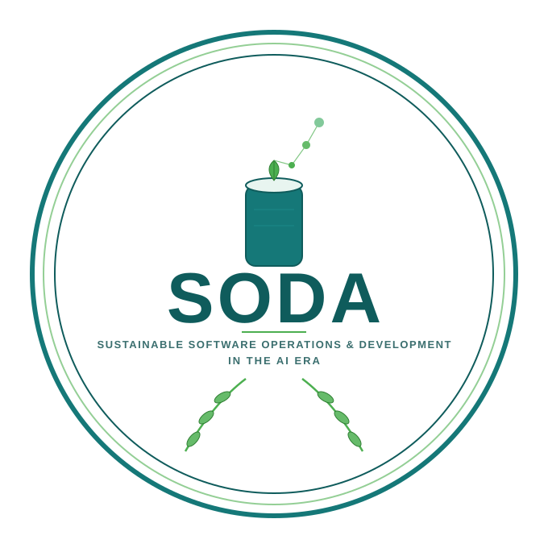

  

## SODA 2027

### International Workshop on Sustainable Software Operations & Development in the AI Era (SODA)

*(Formerly known as DevOpsSustain — International Workshop on DevOps for Sustainability)*

**Location, date, and venue: to be announced.**

### Call for Papers

Information and communication technologies (ICT) are causing ever-growing energy consumption and carbon emissions. Software is at the center of ICT, from large-scale data centers to personal devices, and the rise of AI-based systems is further accelerating this trend. Thus, improving the energy efficiency of software throughout its development and operation is critical for reducing the energy footprint of ICT and contributing to sustainable development. Modern software engineering practices such as DevOps aim to enhance the velocity of releasing high-quality software through automation and the integration of development and operations responsibilities, while the growing adoption of AI is reshaping both how software is built and how it is operated. On the one hand, fast release cycles and the increasing use of AI pose significant challenges for ensuring the energy efficiency of software and its deployment environment. On the other hand, they also provide great opportunities for enhancing software sustainability, since the tight integration between development and operations allows for continuous collection and analysis of energy consumption data, and AI itself can be leveraged as a tool for optimizing the energy efficiency of software and its deployment environment.

The International Workshop on Sustainable Software Operations & Development in the AI Era (SODA) provides a platform for researchers and practitioners to discuss the challenges and opportunities at the interplay of software development, operations, and sustainability, with a particular focus on the impact and potential of AI.

This workshop edition will explore topics related to:

- Energy measurement, profiling, and monitoring
- Testing for energy efficiency
- Energy optimization in software deployment
- Energy consumption modeling/characterization
- Energy considerations in software development lifecycles
- Energy-aware operations and deployment
- Energy benchmarking
- AI for software sustainability
- Sustainable development and operation of AI-based systems
- Energy anomaly detection and root cause diagnosis
- Empirical studies on software energy consumption
- Energy consumption of AI-based or data-centric systems
- Industry reports on sustainable development and operations

### Submission

Authors are invited to submit original, unpublished papers that are not being considered in any other venue.

We accept three types of submissions, as described below. The page limits include references.

- Technical Research/Experience Papers (long papers, up to 10 pages): This track is defined for papers that report innovative research or significant experiences that are closely aligned with the themes of the workshop.

- Ideas, Visions, Reflections, or Working-in-Progress Papers (short papers, up to 4 pages): This track is defined for submissions that propose radical and innovative ideas, pioneering research directions, provide insightful reflections and lessons from past experiences, or discuss early results of significant research.

- Extended Abstract (for presentations only, up to 2 pages): This track is defined for demos or industry presentations.

Papers should be prepared using the ACM double-column conference proceedings format (in LaTeX, ``\documentclass[sigconf,screen,review,anonymous]{acmart}``). The submission site and detailed formatting and publication requirements will be announced once the co-located venue is confirmed.

In order to ensure the fairness of the reviewing process, the workshop will employ a double-anonymous review process where reviewers (except PC chairs) do not know the identity of authors, and authors do not know the identity of reviewers. Papers submitted must not reveal the authors’ identities in any way. More details about the double-anonymous review process will be provided closer to the submission deadline.

### Important dates

To be announced.

### Organizing Committee
- Heng Li, Polytechnique Montréal, Canada, heng.li@polymtl.ca
- Luca Traini, University of L’Aquila, Italy, luca.traini@univaq.it
- Lizhi Liao, Memorial University of
Newfoundland St. John’s, Canada lizhi.liao@mun.ca
- Andreas Brunnert, Munich University of Applied Sciences HM Munich, Germany, brunnert@hm.edu
- Maryam Ekhlasi, Polytechnique Montreal, Canada, maryam.ekhlasi@polymtl.ca

### Technical Program Committee

TBD
