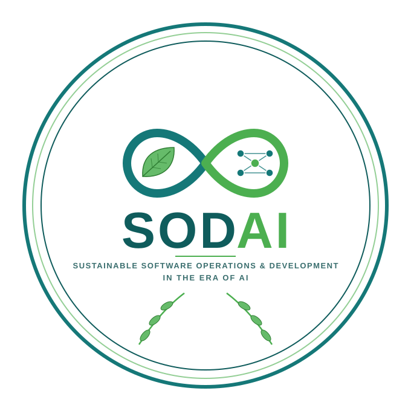

<!-- 

  

 -->

<!-- ## SODAI 2027

### International Workshop on Sustainable Software Operations & Development in the Era of AI (SODAI 2027) -->

*(Previously known as DevOpsSustain — International Workshop on DevOps for Sustainability)*

**Location, date, and venue: to be announced.**

### Call for Papers

Information and communication technologies (ICT) are causing ever-growing energy consumption and carbon emissions. Software is at the center of ICT, from large-scale data centers to personal devices, and the rise of AI-powered systems is further accelerating this trend.  Thus, improving the energy efficiency of software throughout its development and operation is critical for reducing the energy footprint of ICT and contributing to sustainable development. Modern software engineering practices such as DevOps aim to enhance the velocity of releasing high-quality software through automation and the integration of development and operations responsibilities, while the growing adoption of AI is reshaping both how software is built and how it is operated. On the one hand, fast release cycles and the increasing use of AI pose significant challenges for ensuring the energy efficiency of software and its deployment environment. On the other hand, they also provide great opportunities for enhancing software sustainability, since the tight integration between development and operations allows for continuous collection and analysis of energy consumption data, which can be leveraged as feedback for optimizing the energy efficiency of software and its deployment environment.  As software systems grow more complex and demanding computationally, there is a critical need for integrated, automated practices that reduce energy consumption, minimize carbon footprints, and optimize resource utilization. At the same time, the increasing adoption of AI agents, and other computationally intensive technologies throughout the software development lifecycle introduces new sustainability challenges. Addressing these challenges requires considering not only the efficiency of software systems during execution, but also the sustainability of the processes, tools, and infrastructure used to design, develop, test, deploy, and maintain them. We welcome contributions introducing novel methods, toolchains, empirical studies, and reproducible evaluations that address sustainability across different stages of the software lifecycle. Relevant work may focus on improving the sustainability of the software development process, reducing the environmental impact of software execution and operations, or jointly optimizing both dimensions.

The International Workshop on Sustainable Software Operations & Development in the Era of AI (SODAI 2027), previously known as DevOpsSustain, provides a forum for researchers and practitioners to discuss the challenges and opportunities at the interplay of software development, operations, and sustainability in the era of AI-powered software.

Topics of interest include, but are not limited to:

- Sustainable development/operations of AI-powered software systems (e.g., AI agents)
- Sustainability considerations in agentic software engineering or traditional software development lifecycles
- Measurement/testing/profiling/monitoring of energy efficiency or other sustainability aspects
- Modeling/characterization/optimization of energy efficiency or other sustainability aspects in software development, deployment, or operations
- Benchmarking of energy consumption or other sustainability aspects
- Energy anomaly detection and root cause diagnosis
- Empirical studies on software energy consumption or other sustainability aspects
- Industry reports on sustainable development and operations

### Workshop Format

SODAI 2027 is planned as a half-day workshop. The program will tentatively include a keynote, presentations of technical research/experience papers, ideas/visions/reflections or work-in-progress papers, demos, and industry presentations.

### Submission

Authors are invited to submit original, unpublished papers that are not being considered in any other venue.

We accept three types of submissions, as described below. The page limits include references.

- **Technical Research/Experience Papers** (long papers, up to 10 pages): This track is defined for papers that report innovative research or significant experiences.

- **Ideas, Visions, Reflections, or Working-in-Progress Papers** (short papers, up to 4 pages): This track is defined for submissions that propose radical and innovative ideas, pioneering research directions, provide insightful reflections and lessons from past experiences, or discuss early results of significant research.

- **Extended Abstract** (for presentations only, up to 2 pages): This track is defined for demos or industry presentations.

Papers should be prepared using the ACM double-column conference proceedings format (in LaTeX, ``\documentclass[sigconf,screen,review,anonymous]{acmart}``). The submission site and detailed formatting and publication requirements will be announced once the co-located venue is confirmed.

In order to ensure the fairness of the reviewing process, the workshop will employ a double-anonymous review process where reviewers (except PC chairs) do not know the identity of authors, and authors do not know the identity of reviewers. Papers submitted must not reveal the authors’ identities in any way. More details about the double-anonymous review process will be provided closer to the submission deadline.

### Important Dates

To be announced.

### Organizing Committee

- Andreas Brunnert, Munich University of Applied Sciences HM, Munich, Germany, brunnert@hm.edu
- Heng Li, Polytechnique Montréal, Montréal, Canada, heng.li@polymtl.ca
- Lizhi Liao, University of Guelph, Guelph, Canada, lizhi.liao@uoguelph.ca
- Luca Traini, University of L’Aquila, L’Aquila, Italy, luca.traini@univaq.it

### Technical Program Committee

TBD

### Previous Editions

SODAI was previously known as DevOpsSustain (International Workshop on DevOps for Sustainability).

- [DevOpsSustain 2026](https://devopssustain.github.io/ws2026/), co-located with FSE 2026
- [DevOpsSustain 2025](https://devopssustain.github.io/ws2025/), co-located with FSE 2025
